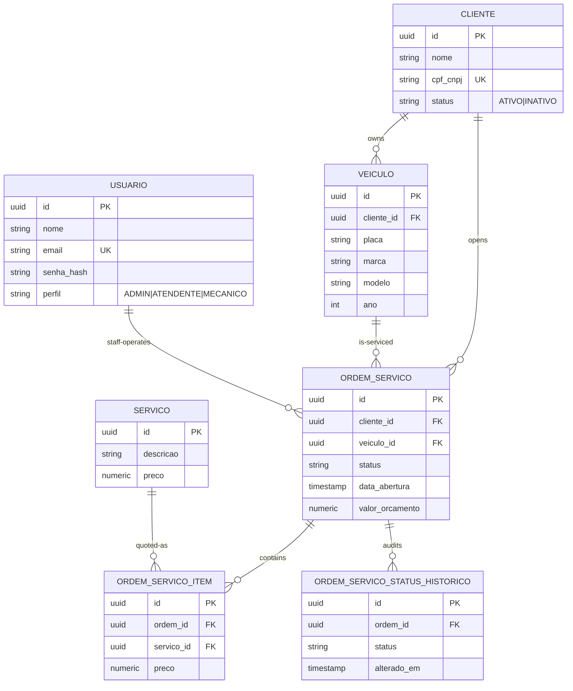

# Logical data model (ER) — oficina-api

PostgreSQL remains the system of record. The managed instance (simulated RDS) lives in namespace `oficina-db`. Hibernate `update` plus `data.sql` keep the schema and seed data aligned for the course demo.

## Why PostgreSQL (relational)

- Work orders are strongly consistent transactions (client + vehicle + items + status history).
- CPF lookup must be exact and unique; relational unique indexes enforce that without a document store.
- Status history is an append-only child table, ideal for SQL and for the observability/audit requirement.
- The course target on AWS is RDS PostgreSQL; the local Terraform release in `oficina-db` is the same contract (`postgres.oficina-db.svc.cluster.local:5432`).
